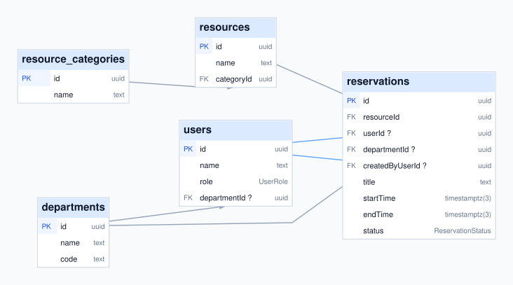

<p align="center">
  
</p>

# Slotify — Resource Reservation Management System

<p align="center">
  
  
  
  
</p>

Slotify is a full-stack application for reserving shared rooms, workspaces, and equipment. Members can find availability and request bookings; administrators manage resources, people, departments, approvals, and scheduling policies. It was built for the **PrimeWave Lab Software Engineering Internship Technical Assessment**.

## Live application

[**Open Slotify →**](https://slotify-bay-mu.vercel.app/)

The public home, login, and signup routes returned HTTP 200 on 2026-10-15. An authenticated production workflow and the demo login below have **not** been verified on this deployment.

## Main features

- **Availability and booking:** Resource catalog, filters, daily timeline, reservation calendar, booking requests, and personal booking history.
- **Approval workflow:** Administrators can approve or reject requests, cancel bookings, and edit booking times. Time changes and department corrections have audit records.
- **Administration:** User roles, departments, resource categories, resources, and office shifts, including overnight and full-day schedules.
- **Updates and insight:** Booking notifications, dashboard schedule, usage statistics, and department analytics backed by PostgreSQL.
- **Responsive interface:** Mobile navigation and contained timeline scrolling; booking details provide a time-edit path on touch screens.

## Technology stack

| Area | Implementation |
| --- | --- |
| Application | Next.js 16 App Router, React 19, TypeScript |
| Interface | Tailwind CSS 4, Lucide React |
| Authentication | Auth.js Credentials, Argon2id password hashing |
| Validation | Zod and server-side authorization |
| Data | PostgreSQL, Prisma ORM 6.4.1, SQL migrations |
| Hosting | Vercel application, Neon PostgreSQL |

## System architecture

Next.js routes and layouts live in `src/app`; domain code is grouped in `src/features` by authentication, reservations, resources, departments, administration, notifications, office shifts, and dashboard. Server Actions validate inputs and permissions, then use feature services and the shared Prisma client in `src/lib/prisma.ts`. PostgreSQL constraints provide a final integrity check when concurrent requests reach the database.

The [authentication](docs/auth-api-contract.md), [reservation](docs/reservation-api-contract.md), [time-edit](docs/admin-reservation-time-edit-contract.md), [office-shift](docs/office-shifts-api-contract.md), and [dashboard](docs/dashboard-api-contract.md) contracts document key behaviors. See the [QA report](docs/final-qa-report.md) for staged verification history and remaining cloud checks.

## Database architecture and ER diagram

The reviewed schema contains **11 application tables, 18 foreign keys, and five PostgreSQL enum types** across 13 migrations. Reservations link a resource, optional owner and creator, and department; separate tables preserve notification, department-correction, and time-change history. The diagram shows physical PostgreSQL names and relationships. SQL-only checks, triggers, partial indexes, and the booking exclusion rule are detailed in the [database architecture notes](docs/database-architecture.md).

[](docs/slotify-erd.svg)

[Full SVG](docs/slotify-erd.svg) · [PNG](docs/slotify-erd.png) · [Editable DBML](docs/slotify-erd.dbml) · [Database notes](docs/database-architecture.md) · [Shareable dbdiagram.io view](https://dbdiagram.io/embed#c=pako%3AeJzFWN9v2zYQfs9fwbc2QOK26PawulvgOmri1XZSyQk2FIXASLRNRKJUkkriDf3fd5REi5JoWU3a9SVWpLsj777vfpAvXiAvSiRdblC63gga4AhdJkKuOPE%2BTpEI1iTGQ7QijHAsSYiWPInRJacixihOQhKhmEgcYokRZiHi5I6Se5DDK0yZkOjVa6QMxXQF%2BjRhYnDgsCxGV4JwN4kI%2BvcAodHpbDKH35kze%2Be4B18PChmXgNBdruZJLDORC18689PJ%2FEypXV66F9fOKTy6zp%2FOeJE%2FjkfzsTOdwrO2M1cOgmvK0GKTFmu6jue416PF5GLuu87HK8dblJaq97UFTPHtYubr9sIXS1iWeGu6lDOIVb7u7MKdF9t3rp3yaT45O1%2FA7%2Fur6dQ%2FHf2tvLjyFhezrSUnxjQar3EUEbYilxlPE6H9OJt4CzffgjI6G02m%2Fvh8ND9zlPYC30CQMwhkET0aoiyDP5%2FS2yPEEolYFkWf4QPDMUGSPEj0yXy9pFzIuf4GLyJc%2F5%2BonZWKGaNfMlK3yxXIW7RrtlMsxH3Cw3Ms1tocFaNA0juCbhKQx6yukS92TTjAScKRRJLGREgcp%2FKf568P6wIF3i75klFuFxZECBABcfWDKJNkRXh9xZCkmMuYMDnRkYPP5A169v4DkonxXQxoOEQXc3TqTJ2Fo6ixcCfjxTNlJuBEpU9rF%2FXFsjTcK6VixELyQAo8EXpublG59VXJzItNjsBJ%2BApWUQFOoYzA3Si5J%2Fx5HrBDRNgy4QHYDLAgx5C5hAma41DgWygzCNgwZ8AxzlE6xmFMGZKcrlTkUg6rBlIUCY1wABbF4FnFw9yYf2fg4wea1Hv4qShsQpB%2FyEUqMHKaN2AYj7zx6NTJUaAMfFIRfre5apjrNuI5CzSH5MytpGX22XOyBqjEfEWkY6SI%2BTWAmrDlfoPoDymwVuzhC5aSwAfhqrgyylZ2DoMhwsJxkjFpF1CIesCfPcsFUL6z2J5LP5LgBfRHOvBH1WJKEWoRYFcwqyKTr5T8UsMvFXwaPuQQglEDmg4rhtRW2cyv8bkz%2FmDB4eVg8GvZEKvY%2F%2FE7ejlEKlkpjmr5CL5C%2FsErHeKt06UHh7mxImXNnZvJleTdxheq3fQv9raarRp7q3k1yqIIOE1VBuvKDWhyOaMsk2RHKc2KEaCQEXah7vpf8udJ6fsjmap33yzDBU3MCAFBXv3y%2BrdhKyqv1IdfgCd6GAAK5S0MPuXvbfxBKeExBdQTFm3gD0FFfUY5GUySGP3qSRRRtavjs4Uf3cj%2BDFQ8W2skomqOKgZm5imnt72y3SqrJmlGHGdy7atl%2FIjmGKld3ZJNGb1m3HUt2V3Ku8t02%2F1Sp%2FB%2Buy14m2Tghg99mKwSTvc14D2E%2BLmIdyHaxHP3rGMHUEfqcQO0JS5lxDf7xhkLRF0zZpQUI5Vt0sApDqjcaFL91HSs3D%2B05acZd3382xN6Hai%2BAe0MY3PQ7G4tNdXve1j41i5XsyGpjGx0zHvQgiqqdgALI8teGVEcyduH9P%2BNSBXsR5VfR3rzh%2BbwWPvHkD5sH6HaXxt4lG8L%2Fzs6fR7Bt3o7Q3RGvQVy%2FhpPr04dVZMM1qoWA0Pn8jhJCWRi5Yz2JR8Py5sPBI%2F6ZmKoYVAWKi%2BQqmpc6oOZGCCPQCfiwZqqA1rGYRBIgkyJNiqdxtKvjPlBwjlo9cpDrd8jFbfJ3cXjVN0oJZk4%2FT6pxci93ZJtj33TtQiPLWH7HlJr9oBtwl7Fe%2BSSvf1vQTHPTiW5m7u3M7rcFBXgDLuJMLsdIpwCW8PjfObEWUglutmol1F5tlcHxjuIHjzuYplyRJ239p%2F%2FfwC3inW%2FF2yaqV6vCqulnR6VFkjbzygI9rFX%2Bv1EHmkjmkf1YNpZpL3OyxXsNp9HwGgkEMHBGmqgOrMoX4vCOazRqeBYslQjy606ZavtlxupTWzMuPDdS6uAphRI%2BlgOmPdLcOhK%2BBOOpjs43ovZNUNS3XK3rr3rV1M7BgQghMAr2xcqXILDp8yLIGS5PLJRrQbKUbl0u3i1BNsCRkTLdwZK24nTJcs3jXqPTt6elJDV5rpPIYmIwgRsQ38N5OdCW6OLQK3znnNQTphbQ3AOCXBImnZO9hpq32dubcKRrwx722jtomjQvFPZZcJ%2BGlHeVmO1cbLZFSZzBi%2BVK0obI9HeMJ80lZthbSha0K2pfxvILfXm0N7hv5nCjRDsGLsG9crwOBd32baOWD2X6LdCc%2Brqk0I9zLYHr0cG3ZxCeoZ611ZrppoDRh9jtd41aLanPjWjbsHsSR2pXQtP28qOoFR2%2FgNPolPt)

The dbdiagram.io link is the existing stateless DBML-in-link view, not a saved project. The editable source is `docs/slotify-erd.dbml`.

## User roles and permissions

| Capability | ADMIN | MEMBER |
| --- | :---: | :---: |
| Browse resources and availability | ✓ | ✓ |
| Request a booking | ✓ | ✓ |
| View reservation records | All | Eligible own bookings |
| Manage eligible own requests | ✓ | ✓ |
| Approve, reject, cancel, or adjust organizational bookings | ✓ | — |
| Manage users, departments, categories, resources, and office shifts | ✓ | — |

Protected pages and Server Actions check the current user against PostgreSQL; hiding an action in the interface is not the authorization boundary.

## Demo Admin Access

**Email:** `admin@gmail.com`

**Password:** `admin@123`

These credentials are supplied for demonstration and assessment. They were verified against the configured **local** demo database on 2026-10-15, but login at the live URL has not been verified. A fresh seed uses its own locally configured demo accounts and does not automatically create or reset this supplied account.

## Installation and local development

**Requirements:** Node.js 20.9 or later, pnpm 10, and PostgreSQL 14 or later. The repository contains `pnpm-lock.yaml`.

```bash
# From the repository root
pnpm install --frozen-lockfile
cp .env.example .env
# Configure .env as described below.
pnpm exec prisma generate
pnpm run db:deploy
pnpm run dev
```

Open `http://localhost:3000`. For a fresh local database, the optional seed steps below provide starter departments, resources, and accounts. Do not run seed commands against a database containing data you intend to preserve without reviewing their effects.

## Environment variable configuration

Copy `.env.example` to ignored `.env`. Use values for **your own** local database and deployment; these placeholders are illustrative, not working credentials.

```dotenv
DATABASE_URL="postgresql://<user>:<password>@localhost:5432/<database>?schema=public"
AUTH_SECRET="<long-random-secret>"
AUTH_URL="http://localhost:3000"
```

| Variable | Purpose |
| --- | --- |
| `DATABASE_URL` | Prisma PostgreSQL connection; local/direct for setup, pooled Neon endpoint for Vercel runtime. |
| `AUTH_SECRET` | Secret used by Auth.js; required. |
| `AUTH_URL` | Exact local origin; deployment value depends on the hosting configuration. |
| `AUTH_TRUST_HOST` | Used in the verified Vercel Preview configuration so Auth.js accepts the deployment host. |
| `NEXT_PUBLIC_APP_NAME`, `NEXT_PUBLIC_APP_URL` | Present in `.env.example`; not required by current application code. |

`SLOTIFY_DEMO_ADMIN_PASSWORD` and `SLOTIFY_DEMO_MEMBER_PASSWORD` are local seed inputs. Keep them out of Vercel. `SLOTIFY_RESERVATION_TEST_MODE` enables a localhost-only integration harness and must remain unset in deployment. Never commit `.env` or connection strings.

## Database migration and setup

For a **new, confirmed** local database, run `pnpm run db:deploy` to apply the reviewed migrations. `pnpm exec prisma generate` creates the client; `pnpm run build` also generates it automatically. To populate a disposable/local demo database, run:

```bash
pnpm run db:setup-demo
pnpm run db:seed
```

`db:setup-demo` fills missing local secrets in the ignored `.env` without printing them. The repeatable seed creates missing demo records; it does not rotate existing account passwords or roles. See [database architecture](docs/database-architecture.md) for the `btree_gist` extension and PostgreSQL constraints. Use `pnpm run db:migrate` (`prisma migrate dev`) only while developing reviewed schema changes, not on a hosted release database. Never use `prisma migrate reset` on an existing application database.

## Application usage

1. Open the live application or local server and sign up as a MEMBER, or sign in with an account already provisioned in that environment.
2. Browse Resources, select a date, inspect availability, and submit a reservation request.
3. Review bookings in Reservations and read updates in Notifications.
4. As an ADMIN, use Administration to manage organization data, review pending requests, and maintain the office shift. Booking details expose the authorized time-edit controls.

## Security and reservation conflict prevention

Auth.js sessions, Argon2id hashes, rate limits, and server-side role checks protect account and mutation flows. New bookings are checked against office shift hours and existing occupancy. PostgreSQL's GiST exclusion constraint blocks overlapping `PENDING` and `APPROVED` intervals for the same resource, regardless of department; intervals are half-open, so adjacent bookings are allowed. `REJECTED` and `CANCELLED` records remain in history without blocking availability. Time edits use an optimistic concurrency token and record an audit entry after a successful update.

## Testing and quality assurance

```bash
pnpm run typecheck
pnpm run lint
pnpm run build
pnpm run test:timeline-range
pnpm run test:timeline-interactions
```

Other suites cover authentication, reservations, notifications, departments, administration, time edits, and dashboard behavior. They use PostgreSQL and, where applicable, the localhost-only test route. Run database-backed tests only on an appropriate isolated target; the office-shift suite has a guarded disposable-database runner: `pnpm run test:office-shifts:isolated`. The [QA report](docs/final-qa-report.md) records earlier local and staging results; it does not certify the current live deployment's authenticated workflows.

## Project structure

```text
src/app/           Public and protected Next.js routes
src/features/      Domain components, actions, services, and validation
src/components/    Shared layout and UI components
src/lib/           Database client and application utilities
prisma/            Schema, migrations, and optional seeds
docs/              ER diagrams, API contracts, and QA notes
public/branding/   Official Slotify logo assets
tests/             Automated integration and timeline suites
```

## Deployment information

The application is published at [slotify-bay-mu.vercel.app](https://slotify-bay-mu.vercel.app/). The repository's `build` script runs `prisma generate` before `next build --webpack`; `db:deploy` runs `prisma migrate deploy` as a separate controlled step. For Neon, use a **direct** connection when applying migrations and a **pooled** connection for the Vercel runtime. Confirm the database target before migration, provide distinct environment secrets for each deployment, and keep local demo/test variables unset on Vercel. The [QA report](docs/final-qa-report.md) documents the isolated staging setup and outstanding authenticated cloud checks.

## Author and portfolio

**Menuka Perera** · [GitHub profile and projects](https://github.com/MenukaPerera42) · [Slotify repository](https://github.com/MenukaPerera42/Slotify)
