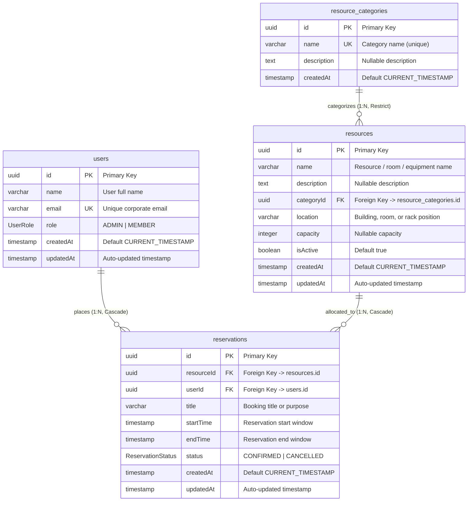

# Entity-Relationship (ER) Diagram & Database Architecture

This document details the PostgreSQL database schema and domain model relationships designed and implemented for **Slotify**.

---

## 1. Mermaid Entity-Relationship Diagram



---

## 2. Model & Relationship Definitions

### `users`
- **Purpose**: Represents organization members scheduling reservations.
- **Primary Key**: `id` (`UUID`, generated via `gen_random_uuid()` / `@default(uuid())`).
- **Uniqueness**: `email` (`UNIQUE`).
- **Enum**: `role` (`UserRole`: `ADMIN`, `MEMBER`).
- **Relationships**: `1:N` with `reservations` (`onDelete: Cascade`).
- **MVP Note**: Serves as the identity foundation for MVP assessment testing without mock session state or fake security.

### `resource_categories`
- **Purpose**: Categorization for shared assets (e.g., *Meeting Rooms*, *Workstations & Pods*, *Lab & Hardware Equipment*).
- **Primary Key**: `id` (`UUID`).
- **Uniqueness**: `name` (`UNIQUE`).
- **Relationships**: `1:N` with `resources` (`onDelete: Restrict`). Prevents accidental orphaned resources if a category is deleted.

### `resources`
- **Purpose**: Physical or digital assets that can be reserved.
- **Primary Key**: `id` (`UUID`).
- **Foreign Keys**: `categoryId` (`UUID`, references `resource_categories.id`).
- **Indexes**: `categoryId`, `isActive`.
- **Relationships**: `1:N` with `reservations` (`onDelete: Cascade`).

### `reservations`
- **Purpose**: Time-bound resource bookings created by users.
- **Primary Key**: `id` (`UUID`).
- **Foreign Keys**: `resourceId` (`UUID`), `userId` (`UUID`).
- **Timestamps**: `startTime`, `endTime` (stored in UTC without timezone offset ambiguity).
- **Check Constraint**: `reservations_start_before_end_check` enforcing `"startTime" < "endTime"`.
- **Indexes**:
  - `(resourceId, startTime, endTime)` compound index for rapid interval overlap querying.
  - `userId` for quick user booking lookups.
  - `status` for filtering confirmed vs cancelled bookings.

---

## 3. Concurrency Strategy & Overlap Prevention

### The Problem with Application-Side Checks
Relying solely on a `SELECT` query followed by an `INSERT` leaves a severe race condition window under concurrent requests. Two transactions executing concurrently can both read 0 conflicts and proceed to insert overlapping bookings.

### The Problem with Composite Unique Constraints
A composite unique constraint such as `UNIQUE (resourceId, startTime)` only checks for exact timestamp equivalence. It **cannot** detect arbitrary interval intersections (e.g., Booking A: 09:00–10:30 and Booking B: 10:00–11:00).

### The Database-Level Solution: PostgreSQL GiST Exclusion Constraint
We leverage PostgreSQL's native `btree_gist` extension and an **`EXCLUDE USING gist`** constraint:

```sql
CREATE EXTENSION IF NOT EXISTS btree_gist;

ALTER TABLE "reservations" ADD CONSTRAINT "reservations_no_overlap_confirmed_excl"
EXCLUDE USING gist (
  "resourceId" WITH =,
  tsrange("startTime", "endTime", '[)') WITH &&
)
WHERE ("status" = 'CONFIRMED');
```

#### Why `[)` (Half-Open Interval)?
- `[startTime, endTime)` includes the exact start millisecond but excludes the end millisecond.
- This permits **adjacent back-to-back bookings** (e.g. 09:00–10:00 followed immediately by 10:00–11:00 on the same room) with zero gaps, while strictly blocking any true overlap.
- The partial clause `WHERE ("status" = 'CONFIRMED')` ensures that cancelled reservations do not block future reservations on that same time window.

